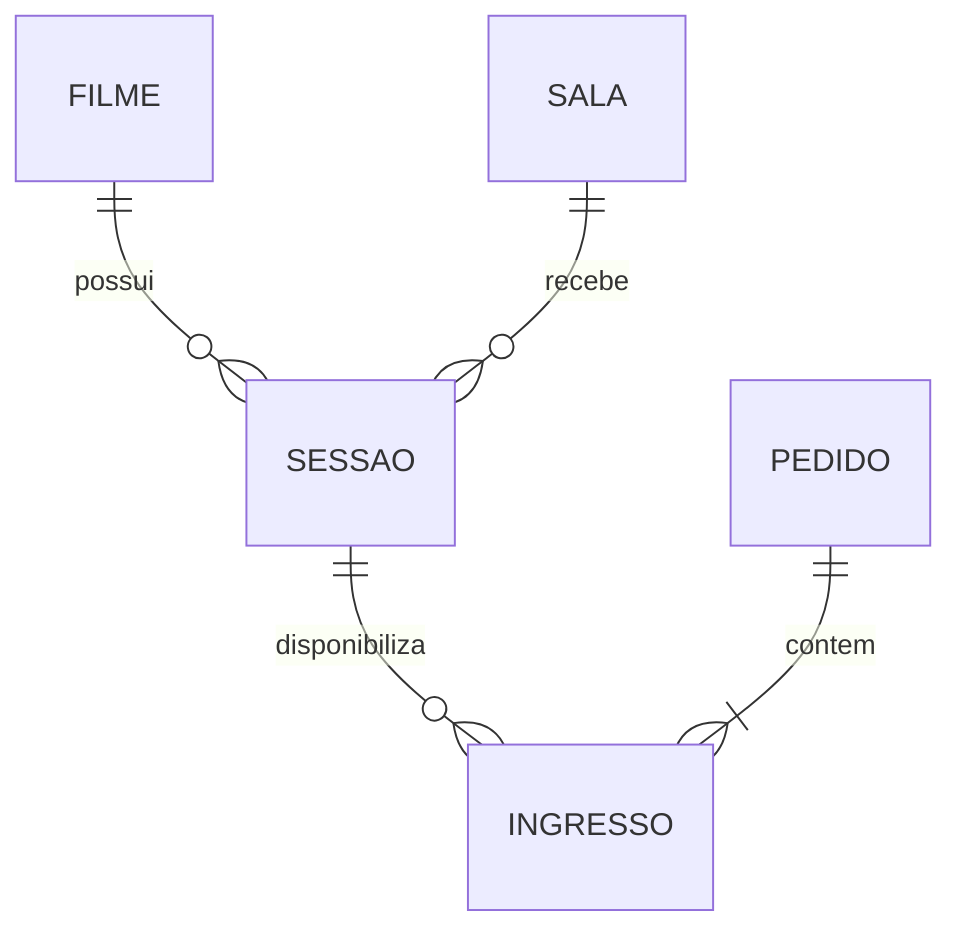

# Projeto Entretenimento e Cultura — Sistema de Ingressos de Cinema

> **Disciplina:** Desenvolvimento Back-end — UNISATC  
> **Tema nº 7:** Entendimento e Cultura  
> **Etapa:** Projeto final — planejamento e desenvolvimento incremental  
> **Status:** arquitetura e funcionalidades propostas; verificar no código quais itens já foram implementados.

## 1. O problema

O projeto propõe uma **API REST para gerenciamento de sessões de cinema e venda de ingressos**. O objetivo é organizar a programação de filmes, evitar conflitos no agendamento das salas e aplicar regras de venda relacionadas à meia-entrada e ao limite de ingressos por pedido.

Atualmente, processos manuais ou sem validações centralizadas podem permitir sessões sobrepostas, vendas acima de limites definidos e cálculos incorretos de preços. O sistema centraliza essas verificações no back-end, garantindo maior consistência dos dados.

### Quem usa o sistema

| Perfil | O que faz |
| --- | --- |
| Administrador/atendente do cinema | Cadastra filmes, salas e sessões; consulta a programação; registra ou acompanha pedidos de ingressos. |
| Cliente | Consulta filmes e sessões disponíveis e solicita ingressos para uma sessão. |

### Escopo

**Incluído no planejamento:** cadastro e consulta de filmes, salas e sessões; registro de pedidos e ingressos; validação de regras comerciais; persistência em banco de dados.

**Fora do escopo inicial:** processamento de pagamento real, integração com bilheterias externas, emissão de nota fiscal, autenticação avançada e aplicativo/front-end completo.

## 2. Regras de negócio

| Código | Regra | Local planejado | Rota relacionada |
| --- | --- | --- | --- |
| **R1 — Cota de meia-entrada** | Ingressos de meia-entrada estão sujeitos ao limite de **40% dos ingressos disponíveis para a sessão**, conforme o recorte adotado da Lei nº 12.933/2013. O preço da meia-entrada é **50% do valor do ingresso inteiro** e é calculado pelo servidor, sem aceitar preço informado pelo cliente. | `IngressoService.criar()` | `POST /ingressos` |
| **R2 — Sessões sem sobreposição** | Uma sala não pode receber sessões em intervalos conflitantes. O tempo de ocupação inclui **horário de início + duração do filme + 20 minutos de limpeza**. | `SessaoService.criar()` | `POST /sessoes` |
| **R3 — Limite por pedido** | Um pedido pode conter **no máximo 6 ingressos**. Quantidades superiores são rejeitadas. | `PedidoService.criar()` | `POST /pedidos` |

### Exemplos e mensagens de erro

- **R1:** Uma sessão com 100 ingressos disponíveis pode destinar até 40 à meia-entrada. Se essa cota estiver esgotada, a nova solicitação de meia-entrada é recusada com a mensagem: `R1: A cota de meia-entrada desta sessão (40%) já foi atingida.` O limite deve ser calculado com base na capacidade de ingressos disponibilizada para a sessão, não no total já vendido. A contagem não deve incluir ingressos cancelados.
- **R2:** Um filme de 120 minutos iniciado às 14h ocupa a sala até **16h20**, incluindo limpeza. Outra sessão na mesma sala só pode começar às 16h20 ou depois. Mensagem: `R2: O horário informado apresenta conflito com outra sessão nesta sala.`
- **R3:** Uma solicitação de 8 ingressos em um único pedido é recusada. Mensagem: `R3: O limite máximo permitido é de 6 ingressos por pedido.`

**Observação sobre R1:** este é um modelo acadêmico simplificado de uma regra legal. A aplicação real da meia-entrada envolve outros critérios de elegibilidade e regulamentação. No projeto, a capacidade, o arredondamento da cota para baixo quando necessário e a verificação dos ingressos já emitidos devem ser tratados de forma consistente. Referência: [Lei nº 12.933/2013](https://www.planalto.gov.br/ccivil_03/_ato2011-2014/2013/lei/l12933.htm).

## 3. Entidades e modelo de dados

O modelo abaixo é a **proposta de estrutura** para o desenvolvimento. Os nomes e campos devem ser ajustados às classes efetivamente criadas no projeto.

| Entidade | Campos principais previstos | Finalidade |
| --- | --- | --- |
| `Filme` | `id`, `titulo`, `sinopse`, `duracaoMinutos`, `classificacaoIndicativa` | Representa um filme e sua duração, usada no agendamento. |
| `Sala` | `id`, `nome`, `capacidade` | Representa a sala de exibição e a quantidade de lugares disponíveis. |
| `Sessao` | `id`, `filme`, `sala`, `inicio`, `precoInteira` | Associa filme, sala, horário e preço-base da sessão. |
| `Pedido` | `id`, `dataHora`, `status`, `valorTotal` | Agrupa ingressos adquiridos em uma operação. |
| `Ingresso` | `id`, `sessao`, `pedido`, `tipo`, `valor`, `status` | Registra ingresso inteiro ou meia-entrada e seu preço calculado pelo servidor. |

### Relacionamentos

- Um **filme** pode possuir várias **sessões**; cada sessão pertence a um filme.
- Uma **sala** pode receber várias **sessões** em horários diferentes; cada sessão utiliza uma sala.
- Uma **sessão** pode possuir vários **ingressos**; cada ingresso pertence a uma sessão.
- Um **pedido** agrupa de 1 a 6 **ingressos**; cada ingresso pertence a um pedido.



> **Decisão de escopo:** nesta primeira versão, os ingressos são controlados por quantidade, sem escolha de poltrona numerada. Se houver reserva de assentos específicos no futuro, será necessário incluir a entidade `Assento` e impedir vendas duplicadas por sessão.

## 4. Arquitetura

A API será organizada em **camadas**, usando **Java e Spring Boot** e banco de dados **PostgreSQL**, com separação entre responsabilidades:

```text
Cliente HTTP (Postman / Insomnia)
          |
          v
Controller (rotas REST, entrada e saída por DTOs)
          |
          v
Service (regras de negócio R1, R2 e R3)
          |
          v
Repository (Spring Data JPA / persistência)
          |
          v
PostgreSQL (banco de dados)
```

| Camada | Responsabilidade | Exemplos planejados |
| --- | --- | --- |
| `controller` | Receber requisições HTTP, chamar services e retornar respostas. | `FilmeController`, `SessaoController`, `IngressoController`, `PedidoController` |
| `dto` | Definir objetos de entrada e saída da API sem expor diretamente as entidades. | `CriarSessaoRequest`, `CriarIngressoRequest`, `CriarPedidoRequest` |
| `service` | Aplicar as regras de negócio e coordenar operações. | `SessaoService`, `IngressoService`, `PedidoService` |
| `repository` | Consultar e gravar dados no PostgreSQL. | `FilmeRepository`, `SessaoRepository`, `IngressoRepository`, `PedidoRepository` |
| `entity` / `model` | Representar entidades e relacionamentos do banco. | `Filme`, `Sala`, `Sessao`, `Pedido`, `Ingresso` |
| `exception` | Padronizar erros de regras de negócio e recursos inexistentes. | `RegraNegocioException`, `GlobalExceptionHandler` |

### Organização de pastas proposta

```text
src/
  main/
    java/.../
      controller/
      dto/
      entity/
      repository/
      service/
      exception/
    resources/
      application.properties
      db/migration/
docs/
  modelo-de-dados.md
  contrato-api.md
README.md
```

**Padrões adotados:** a camada Controller não executa regras de negócio; a camada Service não recebe entidades diretamente do cliente sem validação; os Repositories concentram o acesso aos dados. Alterações no esquema do banco devem ser versionadas por migrations (ex.: Flyway), conforme a configuração adotada na implementação.

## 5. Contrato da API (planejado)

A tabela descreve as **rotas pretendidas**, e não garante que já existam no código.

| Método | Rota | Descrição | Regra relacionada |
| --- | --- | --- | --- |
| `POST` | `/filmes` | Cadastrar filme. | — |
| `GET` | `/filmes` | Listar filmes. | — |
| `GET` | `/filmes/{id}` | Consultar filme por ID. | — |
| `POST` | `/salas` | Cadastrar sala. | — |
| `GET` | `/salas` | Listar salas. | — |
| `POST` | `/sessoes` | Cadastrar sessão, conferindo conflitos de horário. | R2 |
| `GET` | `/sessoes` | Listar sessões. | — |
| `GET` | `/sessoes/{id}` | Consultar sessão por ID. | — |
| `POST` | `/pedidos` | Criar pedido, validando a quantidade de ingressos. | R3 |
| `GET` | `/pedidos/{id}` | Consultar pedido. | — |
| `POST` | `/ingressos` | Emitir ingresso e calcular valor de meia-entrada quando aplicável. | R1 |
| `GET` | `/ingressos/{id}` | Consultar ingresso. | — |

**Exemplo de requisição de criação de sessão:**

```http
POST /sessoes
Content-Type: application/json
```

```json
{
  "filmeId": 1,
  "salaId": 2,
  "inicio": "2026-11-10T14:00:00",
  "precoInteira": 30.00
}
```

**Exemplo de ingresso:** o cliente informa `sessaoId`, `pedidoId` e `tipo` (`INTEIRA` ou `MEIA`), mas **não informa o preço**; o Service determina o valor a partir de `Sessao.precoInteira` e das regras de meia-entrada.

### Respostas HTTP esperadas

- `201 Created`: recurso criado com sucesso.
- `200 OK`: consulta realizada com sucesso.
- `400 Bad Request`: dados inválidos ou violação de regra de negócio (com mensagem clara).
- `404 Not Found`: recurso informado não encontrado.
- `409 Conflict`: conflito de agendamento ou estado, se esse padrão for escolhido na implementação.

> Para exemplos completos de payloads e respostas, desenvolver `docs/contrato-api.md` em conjunto com os DTOs e endpoints reais.

## 6. Validação e testes previstos

| Teste | Entrada/cenário | Resultado esperado |
| --- | --- | --- |
| R1 — cota disponível | Meia-entrada dentro dos 40% | Emissão autorizada com preço de 50% da inteira. |
| R1 — cota esgotada | Pedido de meia após atingir a cota | Rejeição com mensagem R1. |
| R2 — conflito | Nova sessão começa durante outra sessão ou no intervalo de limpeza da mesma sala | Rejeição com mensagem R2. |
| R2 — sem conflito | Nova sessão na mesma sala começa após o período de limpeza | Cadastro permitido. |
| R3 — quantidade permitida | Pedido com até 6 ingressos | Pedido permitido, se demais verificações passarem. |
| R3 — quantidade excedida | Pedido com 7 ou mais ingressos | Rejeição com mensagem R3. |

## 7. Tecnologias planejadas

- **Java** — linguagem principal.
- **Spring Boot** — implementação da API REST.
- **Spring Web** — Controllers e endpoints HTTP.
- **Spring Data JPA** — persistência e Repositories.
- **PostgreSQL** — banco de dados relacional.
- **Flyway** — versionamento do esquema do banco (caso utilizado no template da turma).
- **Postman ou Insomnia** — testes manuais dos endpoints.
- **Git e GitHub** — versionamento e colaboração.

## 8. Execução do projeto

> Esta seção deve ser ajustada após configurar as dependências e o banco de dados na aplicação. Não há confirmação, apenas pelo README, de que a API esteja executável neste momento.

1. Instalar uma versão do Java compatível com o projeto e PostgreSQL.
2. Criar o banco de dados utilizado pela aplicação.
3. Configurar URL, usuário e senha da conexão em `application.properties` ou por variáveis de ambiente; não publicar senhas reais.
4. Executar as migrations, se configuradas.
5. Iniciar a aplicação Spring Boot pela IDE ou pelo wrapper Maven, caso o repositório inclua `mvnw`.
6. Testar os endpoints com Postman ou Insomnia.

## 9. Etapas de desenvolvimento

- [ ] Definir e revisar modelo de dados e relacionamentos.
- [ ] Criar entidades JPA e Repositories.
- [ ] Criar DTOs, Controllers e Services.
- [ ] Implementar o cadastro e a consulta de uma entidade por `POST`, `GET` e `GET /{id}`.
- [ ] Implementar R1 — cota de meia-entrada.
- [ ] Implementar R2 — controle de conflitos entre sessões.
- [ ] Implementar R3 — limite de ingressos por pedido.
- [ ] Criar migrations do banco.
- [ ] Documentar o modelo em `docs/modelo-de-dados.md`.
- [ ] Documentar o contrato em `docs/contrato-api.md`.
- [ ] Executar e registrar os testes.
- [ ] Preparar a apresentação do projeto.

> As caixas acima começam desmarcadas por não haver verificação do estado atual do código. Marcar cada item somente após confirmar a implementação.

## 10. Integrantes

Preencher com os nomes dos integrantes do grupo e respectivas responsabilidades, conforme solicitado pelo professor.

## 11. Referências

- [Lei nº 12.933/2013 — meia-entrada](https://www.planalto.gov.br/ccivil_03/_ato2011-2014/2013/lei/l12933.htm)
- [Repositório de aulas de Back-end — professor Daniel Plácido](https://github.com/placidodaniel/backend-aulas-satc)
- [Repositório do projeto](https://github.com/Nykona512/projeto-entretenimento-cultura)
