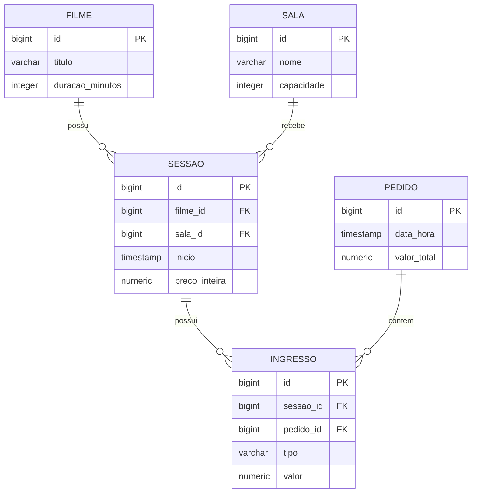

# Modelo de domínio

O sistema possui **5 entidades** e relacionamentos entre filmes, salas, sessões, pedidos e ingressos. A estrutura abaixo corresponde ao código e à migration atual.

## Entidades

### Filme

Filme exibido nas sessões.

| Atributo | Tipo Java | Coluna | Obrigatório | Regra |
|---|---|---|---|---|
| `id` | `Long` | `id` | sim | Gerado pelo banco (`BIGSERIAL`) |
| `titulo` | `String` | `titulo` | sim | `VARCHAR(255)`; `@NotBlank` na entrada |
| `duracaoMinutos` | `Integer` | `duracao_minutos` | sim | Duração ≥ 1 no DTO |

### Sala

Ambiente físico onde acontecem as sessões.

| Atributo | Tipo Java | Coluna | Obrigatório | Regra |
|---|---|---|---|---|
| `id` | `Long` | `id` | sim | Gerado pelo banco |
| `nome` | `String` | `nome` | sim | `VARCHAR(255)`; `@NotBlank` na entrada |
| `capacidade` | `Integer` | `capacidade` | sim | Capacidade ≥ 1 no DTO; usada na cota R1 |

### Sessao

Exibição programada de um filme em uma sala.

| Atributo | Tipo Java | Coluna | Obrigatório | Regra |
|---|---|---|---|---|
| `id` | `Long` | `id` | sim | Gerado pelo banco |
| `filme` | `Filme` | `filme_id` | sim | FK para `filme(id)` |
| `sala` | `Sala` | `sala_id` | sim | FK para `sala(id)` |
| `inicio` | `LocalDateTime` | `inicio` | sim | R2 impede sobreposição, incluindo 20 minutos de limpeza |
| `precoInteira` | `BigDecimal` | `preco_inteira` | sim | `NUMERIC(10,2)`; maior que zero no DTO |

### Pedido

Compra que reúne de um a seis ingressos.

| Atributo | Tipo Java | Coluna | Obrigatório | Regra |
|---|---|---|---|---|
| `id` | `Long` | `id` | sim | Gerado pelo banco |
| `dataHora` | `LocalDateTime` | `data_hora` | sim | Definida pelo servidor |
| `valorTotal` | `BigDecimal` | `valor_total` | sim | `NUMERIC(10,2)`; calculado pelo Service |

### Ingresso

Ingresso associado a uma sessão e a um pedido.

| Atributo | Tipo Java | Coluna | Obrigatório | Regra |
|---|---|---|---|---|
| `id` | `Long` | `id` | sim | Gerado pelo banco |
| `sessao` | `Sessao` | `sessao_id` | sim | FK para `sessao(id)` |
| `pedido` | `Pedido` | `pedido_id` | sim | FK para `pedido(id)` |
| `tipo` | `TipoIngresso` | `tipo` | sim | `VARCHAR(20)`, enum `INTEIRA` ou `MEIA` |
| `valor` | `BigDecimal` | `valor` | sim | `NUMERIC(10,2)`; preço calculado no Service |

## Relacionamentos

| De | Para | Tipo | No banco | No código |
|---|---|---|---|---|
| `Sessao` | `Filme` | muitos para um | `sessao.filme_id` → `filme.id` | `@ManyToOne` em `Sessao` |
| `Sessao` | `Sala` | muitos para um | `sessao.sala_id` → `sala.id` | `@ManyToOne` em `Sessao` |
| `Ingresso` | `Sessao` | muitos para um | `ingresso.sessao_id` → `sessao.id` | `@ManyToOne` em `Ingresso` |
| `Ingresso` | `Pedido` | muitos para um | `ingresso.pedido_id` → `pedido.id` | `@ManyToOne` em `Ingresso` |

## Diagrama ER

Como ler: `||--o{` representa o relacionamento de um para muitos. Por exemplo, uma sala pode ter várias sessões, mas cada sessão utiliza uma única sala.

## Migrations

A migration fica em `src/main/resources/db/migration/`. **A versão atual cria todas as cinco tabelas em um único arquivo**, não uma migration por tabela como sugerem os exemplos do template.

| Versão | Arquivo | O que cria |
|---|---|---|
| V1 | `V1__criar_tabelas.sql` | `filme`, `sala`, `sessao`, `pedido`, `ingresso`, com PKs e FKs |

As tabelas são criadas na ordem necessária para as chaves estrangeiras. A versão inicial não possui assentos numerados, usuários cadastrados nem pagamento real.
