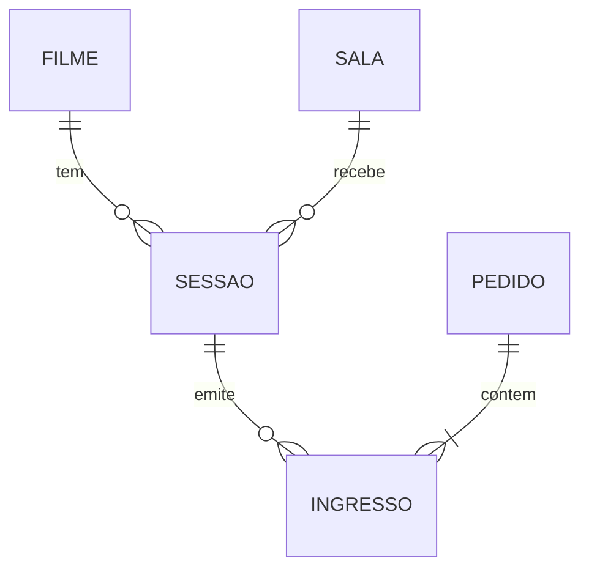

# Modelo de domínio

| Tabela | Colunas | Relacionamentos |
|---|---|---|
| filme | id (PK), titulo, duracao_minutos | Referenciada por sessao |
| sala | id (PK), nome, capacidade | Referenciada por sessao |
| sessao | id (PK), filme_id (FK), sala_id (FK), inicio, preco_inteira | Filme e sala |
| pedido | id (PK), data_hora, valor_total | Referenciada por ingresso |
| ingresso | id (PK), sessao_id (FK), pedido_id (FK), tipo, valor | Sessão e pedido |

As chaves primárias são geradas automaticamente; as FKs são obrigatórias. As tabelas são criadas pela migration `V1__criar_tabelas.sql`. Não há numeração de assentos nesta primeira versão.

## Tipos principais no Java

| Entidade | Campos e tipos |
|---|---|
| `Filme` | `Long id`, `String titulo`, `Integer duracaoMinutos` |
| `Sala` | `Long id`, `String nome`, `Integer capacidade` |
| `Sessao` | `Long id`, `Filme filme`, `Sala sala`, `LocalDateTime inicio`, `BigDecimal precoInteira` |
| `Pedido` | `Long id`, `LocalDateTime dataHora`, `BigDecimal valorTotal` |
| `Ingresso` | `Long id`, `Sessao sessao`, `Pedido pedido`, `TipoIngresso tipo`, `BigDecimal valor` |

A migration `V1__criar_tabelas.sql` define as cinco tabelas e as chaves estrangeiras.
O acesso a entidades acontece pelos Repositories, enquanto os Controllers utilizam DTOs.
